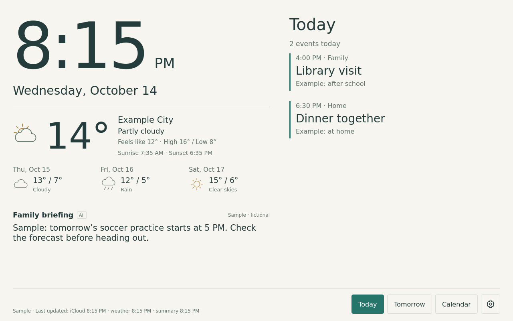

# Porthole

A native Linux family calendar, weather dashboard and optional AI briefing for a
digital photo frame. Built with C++ and Qt Widgets, with no browser required for
the main app.



## What works

- Read-only iCloud calendars through CalDAV, with a dedicated app-specific password
  and remembered sign-in in encrypted systemd credentials.
- Today, Tomorrow and Calendar views, local time, weather icons, a three-day
  forecast, and today's sunrise/sunset.
- Light/dark themes, a Wi-Fi picker, touch keyboard and Settings panes.
- An optional bounded AI briefing with morning, noon and 4 PM focus, waking-hours
  change checks, cached restart recovery and local spending limits.
- Accelerometer-driven rotation and matching touch targets in all four directions
  on the verified hardware.

Location, timezone, household roles and priorities are private settings. The
published defaults have no household context or weather location. Preview data
is fictional and uses an example location.

## Hardware and Linux prerequisites

The verified target is a **Portrait PF1007L / Allwinner A33**, sold under the Anna
Bella brand with AiMOR software, a 10.1-inch 1280×800 display and approximately
1 GiB RAM. The running system is Arch Linux ARM on microSD with kernel
**7.2.10-1-armv7-ARCH**. A matching sales listing or model name alone does not
establish board, panel, touch or Wi-Fi compatibility.

The app runs from microSD Linux, alongside the frame's internal Android system.
Porthole does **not** include a universal flashable image or a one-command
installation for an arbitrary frame. Hardware-specific installers in this repo
expect the validated SD system and, where indicated, a prepared bundle with a
checksum manifest and package baseline. Those bundles, original firmware,
backups, private keys and board extraction evidence are not distributed here.

For the SD boot foundation, see the pinned
[upstream Linux project](https://github.com/pangoleen/ormarch-picture-frame/tree/a3d83874aabcae655f245973e6408937a591e39f)
and the [hardware bring-up record](docs/linux-sd-bringup.md). Identify the board,
verify its boot/display/input configuration and establish recovery before writing
media. Keep kernel, modules, device trees and firmware matched. The working
SD-only dashboard does not require rooting or replacing internal Android.

For initial macOS USB inventory:

```sh
python3 scripts/inspect_usb.py
```

This reads sanitized descriptors without configuring the frame. If Android ADB
already exists, `scripts/inspect_android.py --serial <verified-transport>` reads
selected build/hardware facts from that explicitly selected transport. See the
[access/recovery plan](docs/pf1007l-access-plan.md) for investigation details.

## Build and preview the native app

After cloning the repository, run these commands from its root in a Linux build
environment. Dependencies are a C++17 compiler, CMake 3.21+, make, Qt 6 Widgets,
Network, D-Bus and Test development libraries, and libical. Qt 6.12 is the tested
version. The frame runtime also uses Qt Wayland, Sway/seatd, systemd, iwd and
nftables; the D-Bus responsiveness tests need `dbus-daemon`.

```sh
cmake -S linux/native -B local/native-build -DCMAKE_BUILD_TYPE=Release
cmake --build local/native-build -j2
ctest --test-dir local/native-build --output-on-failure
local/native-build/porthole --self-check
local/native-build/porthole --demo --windowed
```

The demo makes no calendar, weather or AI requests. Use `--dark`, `--light` or
`--portrait` to preview those layouts. For a headless fictional screenshot:

```sh
QT_QPA_PLATFORM=offscreen local/native-build/porthole \
  --demo --windowed --capture local/dashboard-preview.png
```

For the physical frame, compile against its matching ARMv7 userspace. An x86 or
ARM64 desktop binary cannot be copied onto the ARMv7 frame. Provision display,
input and orientation support, then the native kiosk, separate calendar service,
credential helper and network services in that order. The reviewed configuration
and bundle requirements are documented in [Linux startup](linux/README.md),
[native app setup](linux/native/README.md),
[persistent accounts](linux/account/README.md) and
[network setup](linux/network/README.md). Inspect each hardware-specific installer
before using it; the source checkout alone is not its required installation bundle.

## Configure an installed frame

1. Open **Settings → Data → Edit location and timezone**. Set your weather label,
   latitude, longitude and IANA timezone, such as `Europe/London`. The default is
   UTC with weather disabled. Set the timezone before connecting calendars.
2. Open **Settings → Wi-Fi**, select your network and enter its password on the
   frame. iwd remembers the connection on the SD card. Confirm that the clock is
   correct before signing in.
3. Create a dedicated [Apple app-specific password](https://support.apple.com/en-ca/102654).
   In **Settings → Calendars → iCloud**, enter your Apple Account email and that password,
   leave **Remember this account** selected if desired, and choose the calendars
   to display. Use **Show password** to check typing. The app reads events and
   does not create or edit them.
4. In **Settings → AI → Edit household context**, describe household members'
   roles, school meal arrangements and relevant routines. Use **Extra family
   priorities** for additional preferences. These settings are optional unless
   you enable the AI briefing.
5. Choose your display theme under **Settings → Display**. Use **Errors & debugging**
   for source health, retry controls and safe diagnostic export.

Private settings are stored atomically at
`/var/lib/porthole-calendar/profile.json`, owned by the calendar service with mode
0600. The GUI edits them through a restricted Unix socket. To prepare a profile
outside the UI, copy the empty template into the ignored local directory:

```sh
mkdir -p local
cp linux/native/profile.example.json local/profile.json
chmod 600 local/profile.json
# Edit your own values, then validate without making network requests:
local/native-build/porthole-calendar --check-profile local/profile.json
```

A configured weather object has `label`, numeric `latitude` and numeric
`longitude`. `familyContext` is limited to 1,600 characters. See the
[profile schema and provisioning instructions](linux/native/README.md#private-household-profile)
for service ownership and installation. Put passwords and API keys in their
credential flows, never in the household profile.

## Optional AI briefing

The installed calendar service uses `gpt-6-luna` through the OpenAI Responses API.
On a Mac connected to the frame's SD Linux USB console, run:

```sh
python3 linux/ai/set-openai-key.py
```

Paste your key at the hidden prompt, then enable the briefing and save settings
under **Settings → AI**. The helper requires the installed fixed-purpose credential
receiver and access to its restricted provisioning command. It does not put the
key in chat, command arguments or a plaintext file.

Briefings contain up to 400 characters. Baselines start at 6 AM, noon and 4 PM in
your configured timezone. Half-hour checks through 9 PM generate an update when
input changes; overnight requests are blocked. Unchanged checks make no API call.
The default local monthly limit is US$1, with a 31-attempt daily cap. Calendar
checks run every minute and weather refreshes every 15 minutes. CalDAV is polled,
not pushed. See [AI setup, cache and spending](linux/ai/README.md) for details.

Enabling AI sends bounded event titles/dates, selected calendar names, daily
weather, household context and priorities to OpenAI. Account identifiers, event
UIDs, descriptions, attendees and locations are omitted from the current request.
The API key stays in the backend and requests use `store: false`.

## Updates over Wi-Fi

A bootstrapped frame checks for signed app releases about hourly over Wi-Fi. Open
**Settings → Data → Software updates** to check immediately or pause automatic
updates. A verified release briefly restarts the dashboard and retains your
settings and saved accounts. Failed startup restores the previous app binaries.

Updates use outbound HTTPS, with no inbound server or device-address discovery.
Publish a signed release after building/testing; pushing source alone does not
update the frame. The signing key stays on the publishing machine. See
[bootstrap, release publishing and recovery](linux/update/README.md). This channel
updates the app/calendar backend, while kernel and firmware remain separate
maintenance work.

## Other previews

The older [web frontend](web/README.md) and
[Android offline preview](android/README.md) remain available for experimentation.
To preview the web version locally:

```sh
python3 -m http.server 8765 --bind 127.0.0.1 --directory web
```

Open `http://127.0.0.1:8765/?demo=1`. It uses fictional data; the native Linux
app is the working live-calendar implementation.

## Privacy and publishing

Keep household profiles, credentials, Wi-Fi profiles, device identifiers,
calendar contents, generated firmware/images and raw diagnostics out of Git.
`local/`, private profile files, build output, signing keys and generated packages
are ignored. Publish only generic source, fictional examples and sanitized notes.
Check staged files before pushing.

Credentials use systemd host-key encryption on the SD card. This protects ordinary
unprivileged process access; possession of the complete card or root access can
allow credential recovery. The firewall blocks unsolicited inbound connections
but does not isolate the frame from other devices on the same LAN. See
[account storage](linux/account/README.md) and the
[privacy plan](docs/privacy-and-hardening-plan.md) for the implemented boundaries.

## License

[MIT](LICENSE).

## Google Workspace calendars

Google Calendar can appear alongside iCloud in the native dashboard and AI briefing.
Create a private Desktop OAuth client, sign in once through your Mac browser, and
choose calendars in Settings → Calendars → Google. The frame remembers its encrypted
refresh credential and then checks directly over Wi-Fi. See the complete
[Google setup guide](linux/google/README.md), including Workspace administrator
permissions and the seven-day limit for external apps left in Testing.
An [agent activation guide](linux/google/AGENT-SETUP.md) covers the later
credential bootstrap, sign-in, deployment, and privacy-safe verification.
